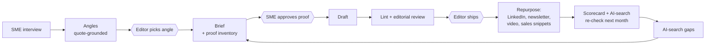

# Content Engine

**An AI-native operating system for a B2B content team, built so AI does the production and
people make the calls.**

It turns one 30-minute expert interview into a brief, a draft, an editorial review and a week of
channel-ready posts. It also tracks whether the brand shows up when buyers ask ChatGPT or
Perplexity, and tells you which pages to protect, refresh, merge or kill based on pipeline, not traffic.

Built by [Colin Maguire](#about). If you're hiring a content leader, start with
**[BEAT_CLAUDE.md](BEAT_CLAUDE.md)**: it's the 3-minute version of how I think.

---

## Why this exists

Every content team has access to the same model. Handed a blank prompt, it produces the same
competent, generic article for everyone. On the example in this repo, that article contradicts the
company's own expert, repeats the category myth the expert wants to kill, and invents two statistics.
The linter scores it **44/100** ([see why](BEAT_CLAUDE.md)).

The advantage isn't the model. It's the system around it: what the model is fed, what it's forbidden
to do, and where a person has to sign off.

## What's inside

| Part | What it does | Run it |
|---|---|---|
| **Pipeline** ([`engine/pipeline.py`](engine/pipeline.py), [`prompts/`](prompts/)) | Interview → angles → brief → draft → review → repurpose, with human gates the code won't let you skip | `python -m engine run <run> <stage>` |
| **Editorial linter** ([`engine/lint.py`](engine/lint.py)) | Blocks AI phrasing, rhetorical tics, unsourced numbers and vague claims. Runs with no API key; works as a CI gate | `python -m engine lint draft.md --min-score 80` |
| **AI-search tracker** ([`engine/ai_search.py`](engine/ai_search.py)) | Share of voice and citations across AI answer engines for the questions buyers actually ask; gaps feed the brief stage | `python -m engine ai-search score <project>` |
| **Content scorecard** ([`engine/scorecard.py`](engine/scorecard.py)) | PROTECT / REFRESH / CONSOLIDATE / KILL / WATCH for every page, based on pipeline per dollar, decay and overlap | `python -m engine scorecard inventory.csv` |
| **Voice spec** ([`voice/`](voice/)) | Brand voice as checkable rules plus a shared banned-phrase list | — |
| **Playbook** ([`PLAYBOOK.md`](PLAYBOOK.md)) | The team shape, weekly cadence, metrics and what stays human | — |

## How it works



The hexagons are human checkpoints. Three of them are enforced in code: the brief won't run without
`chosen_angle.md`, and drafting and repurposing won't run without an `engine approve` record.

## Try it in two minutes (no API key needed)

```bash
git clone <this repo's URL> && cd content-engine
pip install -r requirements-dev.txt

# Score a generic Claude draft
python -m engine lint examples/northwind/claude_baseline.md

# AI-search share of voice on the sample data
python -m engine ai-search score examples/northwind/ai-search

# Which pages to protect, refresh, merge or kill
python -m engine scorecard examples/northwind/content_inventory.csv

# Walk the pipeline (writes the full prompts with --dry-run; set ANTHROPIC_API_KEY to run it for real)
python -m engine new runs/demo --interview examples/northwind/interview.md
python -m engine run runs/demo angles --dry-run

# Tests
python -m pytest -q
```

The full worked example is in [`examples/northwind/`](examples/northwind/).

## What stays human

Picking the angle, approving every number, the ship decision, anything published under a person's
name, killing pages, and claims about customers or competitors. The reasoning is in
[PLAYBOOK.md](PLAYBOOK.md#what-stays-human).

## Known limits

- The linter is a floor, not a judge. A draft can score 100 and still be boring.
- AI-search matching is literal (names and domains), so it undercounts paraphrased mentions.
- `ai-search capture` asks Claude without web search, so it measures brand association in the
  model, not live retrieval. Paste ChatGPT and Perplexity answers in for the live picture.
- The scorecard is only as good as the CRM attribution feeding it.

---

## About

I'm **Colin Maguire**, a content marketing leader in Los Angeles with 14 years in technology, healthcare
and regulated industries. At Thatch I grew ChatGPT visibility 871% and AI Overview mentions 1,400% while
cutting $220K+ in annual agency costs. Before that I was Director of Content Strategy at Right Percent
(2020–2025), working with clients like Reddit, Uber, DoorDash and Ramp, and co-founded Layover Marketing
(2015–2020). I teach B2B content strategy and AI search as a guest instructor at NYU Stern.

What I've built, including the AI production system behind Open Athletes and an AI Google Ads diagnostic engine: **[TRACK_RECORD.md](TRACK_RECORD.md)**

colin.maguire88@gmail.com

### AI usage disclosure

This repo was built with Claude (Anthropic) as a coding and drafting partner, which is the way I
work. The operating model, editorial rules and human checkpoints reflect how I run content. Everything
here is reproducible: the tests (`python -m pytest`) and every example output regenerate from the files
in this repo.

MIT licensed.
